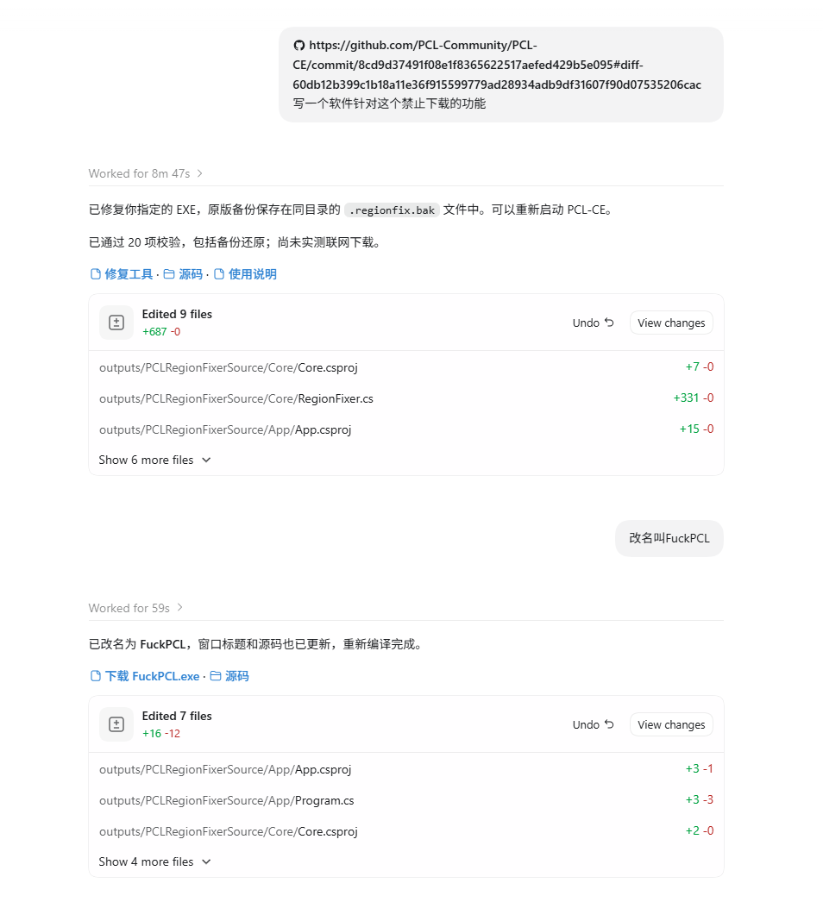

# FuckPCL

> 下载。下载。下载。下载。下载。
>
> 我只是想下载一个 Minecraft。
>
> `IsRestricted`，你已有取死之道。

一个盯着 PCL-CE 地区限制疯狂念诵 `false` 的小工具。

起因是 [这次提交](https://github.com/PCL-Community/PCL-CE/commit/8cd9d37491f08e1f8365622517aefed429b5e095)。看到下载、文件补全和整合包安装一起进入区域结界，我的愿望逐渐清晰：

**把。下。载。还。给。我。**

## 作者的真心话

> 这里有支那猪不？

我们伟大的PCL共产主义还是倒闭了吗，太可惜了

笔者高三美味使用一个阴茎两个睾丸上完两个星期课之后

想要打开PCL绕过[EULA](https://www.minecraft.net/zh-hans/eula)启动我的手艺的时候

我刻在脱氧核糖核苷酸长链里的中国基因被发现于是数罪并罚被伟大的PCL禁止了我的下载

生气的笔者打开Codex浪费了我3mtoken许愿编程了这个FuckPCL

注意！！！真的完全许愿，反正笔者对c#一窍不通没有详细人工审查

反正就是给一个构思玩意写的构思玩意罢了，无需人工审查

顺便宣传一下堪比张学良政变级别的文章，[拯救中国](https://cubk.cn/articles/ideology-of-pcl)

⚠️⚠️⚠️反正笔者买了正版，你们这些沟槽待在中国大陆继续绕过eula吧。。。


## 免费开源，倒卖司马

> **倒卖司马！倒卖司马！倒卖司马！**
>
> 许愿许出来的东西还要搬去卖钱？你的良心已被 GC 回收，脸皮倒是进了永久代。

认准 [原项目地址：isakiooo/FuckPCL](https://github.com/isakiooo/FuckPCL)。软件里的“打开原项目”按钮会带你回到这里，下载和源码免费获取。

## ⚠️ 没有回城卷轴，别闭眼献祭 EXE

> **不自动备份！没有还原功能！点下去就是直接修改你选中的原 EXE！**
>
> 想留退路，动手前自己复制一份原 EXE。备份不会从虚空里长出来，后悔键也不会因为你念三遍 `false` 就出现。

想回到原版，请手动换回自己保存的原文件，或重新下载对应版本的启动器。**许愿可以魔怔，原文件请自己保管。**

## ⚠️ 本项目为许愿式编程产物

**许愿式编程。许愿式编程。许愿式编程。**

本人负责许愿，AI 负责施工，编译器负责点头，CLR 负责执行 `false`。

需求原文只有一句：

> 写一个软件针对这个禁止下载的功能

然后它就长出来了。名字也是许愿许出来的。以下为施法现场：



*图片是初版施法记录；当前版本已移除图中提到的自动备份和还原功能。时代变了，回城卷轴撕了。*

代码由 AI 生成，可能存在缺陷。当前已验证 PCL-CE **2.15.1 x64**，其他版本的兼容性以实际检测为准。

## 如何启动仪式

1. **先退出 PCL-CE，并自行复制保存原 EXE。**给自己留张回程票。
2. 打开 `FuckPCL.exe`，选择你的 PCL-CE EXE。
3. 点击“检测”，再点击“恢复下载功能”。
4. 重新打开 PCL-CE。下载！补全！安装整合包！

启动器更新会覆盖补丁，更新后请重新检测。

## 供奉条件

- Windows x64。
- .NET 10 Windows Desktop Runtime。
- 一个包含对应地区限制模块的 PCL-CE 单文件 EXE。

## 自己炼丹

装好 .NET 10 SDK，在源码目录念诵：

```powershell
dotnet publish App/App.csproj -c Release -r win-x64 --self-contained false -p:PublishSingleFile=true -p:DebugType=none -o publish
```

丹成于 `publish/FuckPCL.exe`。

## 到底念了什么咒

定位内嵌 `PCL.Core.dll` 中的：

```text
PCL.Core.App.Region.RegionAssessment.get_IsRestricted
```

将它的 IL 方法体改成返回 `false`。

`false`！`false`！`false`！地区结界的布尔值终于安静了。

支持已知的未压缩、未签名单文件版本，遇到不支持的构建会停止操作。解除本地地区检查后，实际下载仍取决于网络和服务端状态。

## 许可证

[MIT](LICENSE)。功德归功德，许可证归许可证。
